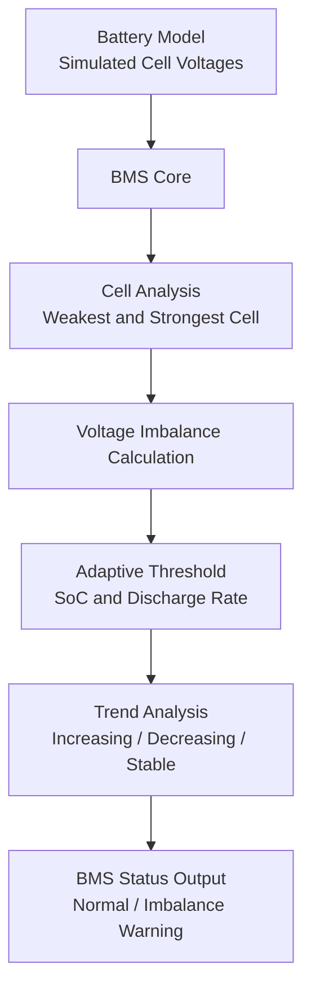

# EV Battery Management System (BMS)
## System Architecture

### 1. Project Overview
This project implements a modular EV Battery Management System using Embedded C. It analyzes simulated battery-cell voltage readings and identifies voltage imbalance.

The software is designed to support configurable battery-cell counts, including 4-cell and 16-cell configurations.

### 2. System Architecture

The system consists of the following modules:

1. Battery Model
2. BMS Core
3. Cell Analysis
4. Adaptive Threshold Calculation
5. Trend Analysis
6. BMS Status Output

### 3. Module Description

#### Battery Model
- Generates simulated battery-cell voltage readings.
- Provides multiple battery profiles.
- Supplies voltage data to the BMS Core.

#### BMS Core
- Processes battery-cell voltage data.
- Identifies the weakest and strongest cells.
- Calculates voltage imbalance.

#### Adaptive Threshold
- Calculates an imbalance threshold using State of Charge (SoC) and discharge rate.
- Limits the threshold to configured minimum and maximum values.

#### Trend Analysis
- Compares current imbalance with previous imbalance.
- Identifies increasing, decreasing, or stable trends.

#### BMS Status Output
- Displays cell voltages.
- Displays weakest and strongest cells.
- Reports voltage imbalance.
- Displays normal or imbalance warning status.

### 4. Data Flow

Battery Model
      |
      v
Cell Voltage Readings
      |
      v
BMS Core
      |
      v
Cell Analysis
      |
      v
Adaptive Threshold Calculation
      |
      v
Trend Analysis
      |
      v
BMS Status Output

### 5. Software Technologies

- Programming Language: Embedded C
- Language Standard: C11
- Development Environment: GitHub Codespaces
- Compiler: GCC
- Target Platform: STM32-oriented embedded software architecture
- Testing: Software-based battery simulation

### 6. Scalability

The number of battery cells is configured using:

#define BMS_NUM_CELLS

The current implementation supports up to 16 cells in the battery simulation model.

The cell count can be changed through the configuration in bms_core.h.

### 7. Testing

The software simulation tests multiple battery profiles and checks:
- Weakest cell identification
- Strongest cell identification
- Voltage imbalance calculation
- Adaptive threshold
- Imbalance trend
- Battery warning status

### 8. Project Limitation

This project currently uses software-generated battery readings. It has not yet been tested on physical STM32 hardware or real battery cells.

## 9. Visual System Architecture

